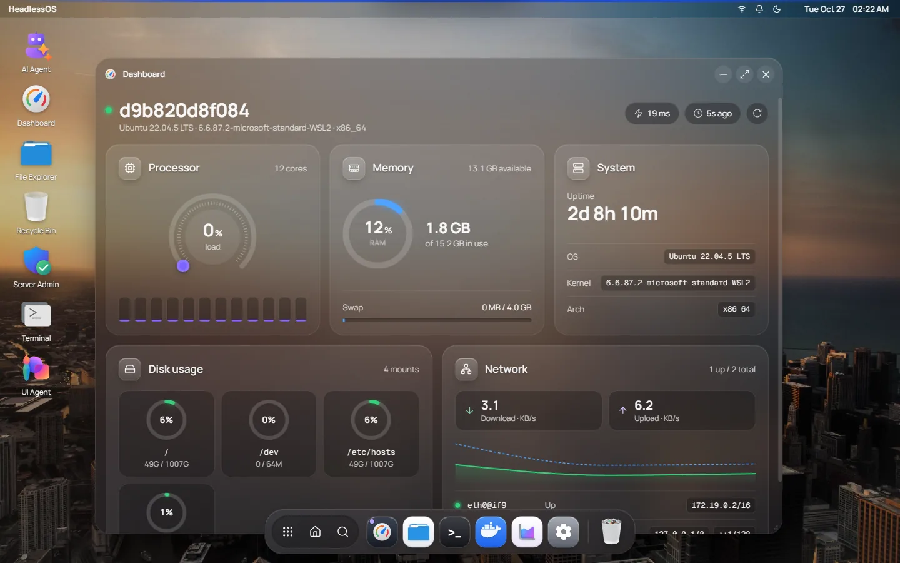
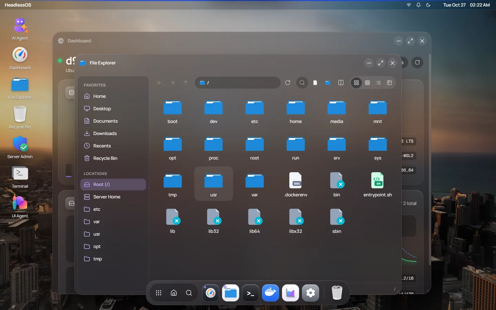
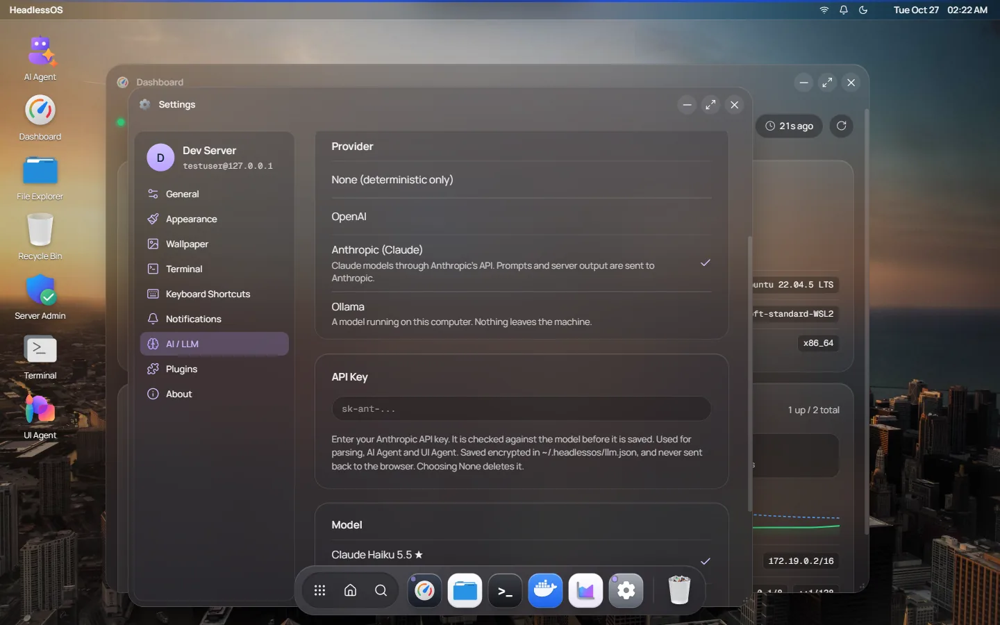

# HeadlessOS

> A local application that turns headless Linux servers into a Windows-like desktop, without installing anything on the server.

## What Is This?

HeadlessOS is a **localhost app** (in the browser or as an Electron desktop app). It connects to your VPS and Linux servers over SSH, runs commands, and parses their output: with deterministic parsers first, and an LLM when no parser fits. It renders the results as a familiar desktop: file explorer, task manager, Docker and services panels, a terminal, and more.

**Zero footprint on the server.** The server doesn't know it's being managed through a GUI. It only receives and answers SSH commands like normal.



## The Problem

You have a VPS. You SSH into it. You can never remember:
- `docker ps --format '{{json .}}'`
- `systemctl list-units --type=service --state=running --no-pager`
- `df -h | awk '{print $1, $5}'`
- `journalctl -u nginx --since "1 hour ago"`

You want a **visual interface**, like Windows Explorer for files, Task Manager for processes and a Docker Desktop-like panel. But you don't want to install a 500MB GUI on a $5/month VPS.

## The Solution

```
┌─────────────────────────────────────────────────┐
│              Your Local Machine                  │
│                                                  │
│  ┌────────────────────────────────────────────┐  │
│  │          HeadlessOS (localhost:3000)        │  │
│  │                                            │  │
│  │  ┌──────────┐ ┌─────────┐ ┌────────────┐  │  │
│  │  │  File    │ │ Docker  │ │  Process   │  │  │
│  │  │ Explorer │ │Dashboard│ │  Manager   │  │  │
│  │  └──────────┘ └─────────┘ └────────────┘  │  │
│  │  ┌──────────────────────────────────────┐  │  │
│  │  │        Interactive Terminal           │  │  │
│  │  └──────────────────────────────────────┘  │  │
│  └────────────────┬───────────────────────────┘  │
│                   │ SSH (ssh2 library)            │
└───────────────────┼──────────────────────────────┘
                    │
            ┌───────▼───────┐
            │  Your VPS     │
            │  (unchanged)  │
            │  Just SSH     │
            └───────────────┘
```

## What's In It

- **Desktop apps:** Dashboard, Files, Terminal, Docker, Services, Task Manager, Server Admin and Settings, in movable windows.
- **Sessions:** one session per server; switch between them and pick up where you left off.
- **AI Agent:** investigates a question about the server ("why is memory high?") and answers with evidence.
- **UI Agent:** builds a custom view from a plain-language request, live as it gathers data.
- **LLM Observatory:** every model and tool call of a run, with tokens, latency and cost.
- **Safe by design:**
  - Agents never run commands a model wrote. They pick typed actions from a fixed catalog, and the server builds and runs the command.
  - Anything that changes a server waits for your approval and is written to an audit log.
  - Secrets are removed from server output before a model sees it.

<table>
  <tr>
    <td></td>
    <td></td>
  </tr>
  <tr>
    <td align="center">Files over SFTP</td>
    <td align="center">Choose the AI: OpenAI, Claude or a local model</td>
  </tr>
</table>

## Key Principles

1. **Zero server install.** The server runs no additional software. All intelligence is local.
2. **Deterministic first, LLM as fallback.** Regex parsers and JSON-output flags come first; an LLM parses only what no parser handles.
3. **Terminal is always available.** The UI is a convenience layer. You can always drop to a real terminal.
4. **Your choice of model.** OpenAI, Claude (Anthropic), or a model running on your own machine through [Ollama](https://ollama.com), behind one provider interface. Without any of them, parsing stays deterministic.

## Tech Stack

| Layer | Technology | Why |
|-------|-----------|-----|
| Backend | Node.js + Fastify + TypeScript | Fast, native WebSocket, great TS support |
| SSH | ssh2 (npm) | Pure JS, multi-channel, SFTP, PTY support |
| LLM | OpenAI SDK, Anthropic SDK (Claude) or Ollama (local), one provider interface | Structured output validated with Zod |
| Frontend | React + Vite + TypeScript + TailwindCSS | Fast dev, modern UI |
| Terminal | xterm.js + addons | Industry standard (used by VS Code) |
| Schema | Zod | Runtime + compile-time type safety, LLM schema generation |
| Desktop app | Electron | The same app as a native window, with the server bundled |

## Project Structure

```
headlessos/
├── docs/                    # 📖 All project documentation (DDD)
│   ├── phases/              # Per-phase specs: phase-0…14 (milestones), phase-ex1…ex11 (experimental)
│   ├── PROGRESS.md          # Task tracker, status, changelog
│   ├── TRACEABILITY.md      # Task → files → tests audit trail
│   ├── DECISIONS.md         # Architecture Decision Records (ADRs)
│   └── …                    # ARCHITECTURE, API_SPEC, SECURITY, TESTING, LLM_STRATEGY, …
├── server/                  # Backend (Node.js + Fastify)
│   └── src/
│       ├── index.ts         # Entry point: wires every component and route
│       ├── ssh/             # SSH connections, SFTP, terminal sessions
│       ├── parsers/         # Deterministic parsers + LLM parsing pipeline
│       ├── llm/             # Provider interface, OpenAI, Anthropic and Ollama providers, model limits
│       ├── agent/           # AI Agent and UI Agent: action catalog, approvals, context management
│       ├── dynamic-ui/      # Generated views, templates
│       ├── observatory/     # Traces of model and tool calls
│       ├── services/        # Domain services, command policy
│       ├── routes/          # REST + WebSocket endpoints
│       └── security/, config/, …
├── client/                  # Frontend (React + Vite)
│   └── src/                 # components/, store/, hooks/, lib/
├── shared/                  # Types and Zod schemas shared by server and client (shared/schemas/)
├── electron/                # Electron desktop app
├── dev/                     # Local test server (Docker, SSH on port 2222)
├── AGENTS.md                # Rules for AI coding assistants
├── SECURITY.md              # Security policy: reporting, what is stored and sent where
├── CONTRIBUTING.md          # Setup, workflow, commit format, checks
└── package.json             # npm workspaces root
```

## Install

Download the desktop app from this repository's **Releases** page:

| Platform | File |
|----------|------|
| macOS (Apple Silicon and Intel) | `HeadlessOS-*-universal.dmg` |
| Windows | `HeadlessOS Setup *.exe` (installer) or `HeadlessOS *.exe` (portable) |
| Linux | No build yet: run from source, or `npm run build:dist:linux` |

The builds may be unsigned, so the first launch shows a warning:
- **macOS:** right-click the app → **Open**, or **System Settings → Privacy & Security** → **Open Anyway**.
- **Windows:** in SmartScreen choose **More info** → **Run anyway**.

Then add a server (host, user, password or key) and connect. To use an AI, open **Settings → AI** and choose OpenAI, Claude or a local Ollama model. Keys are stored encrypted on your computer ([SECURITY.md](SECURITY.md)).

## Run From Source

```bash
# Prerequisites: Node.js 20+, npm 9+

npm install

# Optional: an OpenAI key. You can also add one later in Settings → AI,
# or choose Claude or a local Ollama model there instead.
cp .env.example .env         # .env lives at the repo root

# Start the server (:3001) and the web UI (:3000)
npm run dev
# then open http://localhost:3000
```

**A server to try it on:** `cd dev && docker compose up -d` starts a local Ubuntu container with SSH on `127.0.0.1:2222` (user `testuser`, password `testpass`).

**No key and no model?** Start with `LLM_PROVIDER=fake` to run the UI Agent end to end on scripted answers.

**Tests:** `npm test` runs the server and client suites. Type-check with `npx tsc --noEmit -p server` and `-p client` after `npm run build --workspace=shared` once.

**Desktop app:** `npm run build:dist:win` (or `:mac`, `:linux`).

## Documentation Index

| Document | Purpose | Read When |
|----------|---------|-----------|
| [ARCHITECTURE.md](docs/ARCHITECTURE.md) | System design, components, data flow | Understanding the system |
| [IMPLEMENTATION_INDEX.md](docs/IMPLEMENTATION_INDEX.md) | Phase overview, task ID system | Finding what to build next |
| [phases/](docs/phases/) | Detailed per-phase task specs | Building features |
| [TRACEABILITY.md](docs/TRACEABILITY.md) | Task → files → tests audit trail | Tracking what was built |
| [APP_REGISTRY.md](docs/APP_REGISTRY.md) | How apps work, adding new apps | Adding a new app module |
| [API_SPEC.md](docs/API_SPEC.md) | REST + WebSocket API reference | Writing frontend/backend code |
| [LLM_STRATEGY.md](docs/LLM_STRATEGY.md) | LLM integration, parser migration | Working on parsing |
| [SECURITY.md](SECURITY.md) | Security policy: reporting, storage, what is sent where | Before reporting a vulnerability |
| [docs/SECURITY.md](docs/SECURITY.md) | Threat model, command safety | Any code that executes commands |
| [CONTRIBUTING.md](CONTRIBUTING.md) | Setup, workflow, commit format, checks | Before opening a pull request |
| [TESTING.md](docs/TESTING.md) | Test strategy, how to write tests | Writing or running tests |
| [PROGRESS.md](docs/PROGRESS.md) | Task tracker, current status | Checking what to work on next |
| [DECISIONS.md](docs/DECISIONS.md) | Why decisions were made (ADRs) | Understanding past choices |
| [CONTEXT.md](docs/CONTEXT.md) | Quick briefing for AI assistants | Starting a new AI session |
| [AGENTS.md](AGENTS.md) | Rules for AI coding assistants | AI assistant is helping |

## Development Approach

**Document-Driven Development (DDD):**
1. Every feature is documented BEFORE it's built
2. Documentation is the source of truth — code follows docs
3. When docs and code disagree, docs are updated first, then code is aligned
4. AI coding assistants read [CONTEXT.md](docs/CONTEXT.md) and [AGENTS.md](AGENTS.md) before starting work

## License

[MIT](LICENSE)
