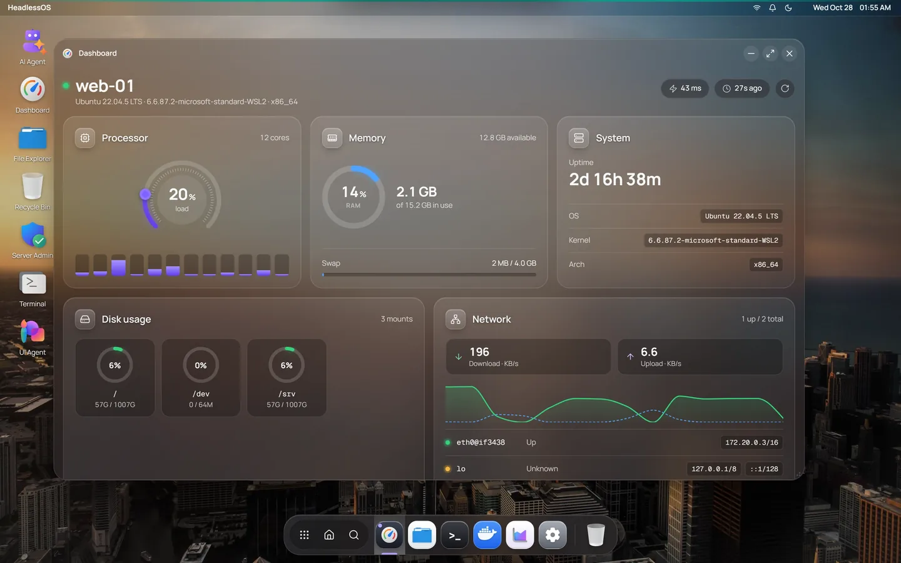
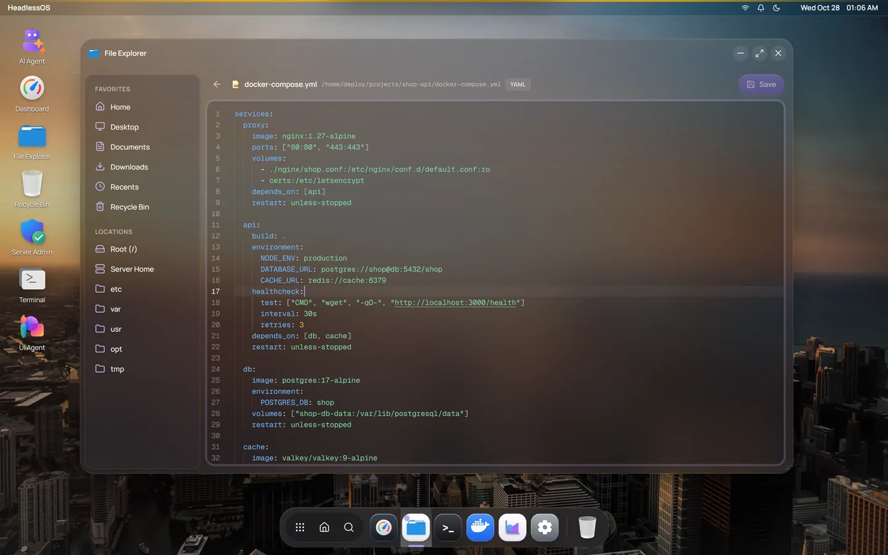
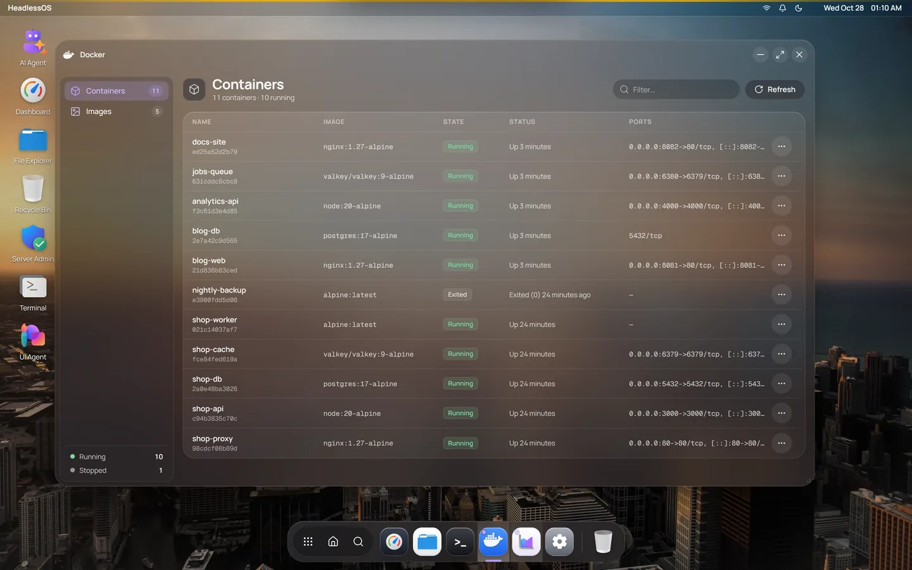
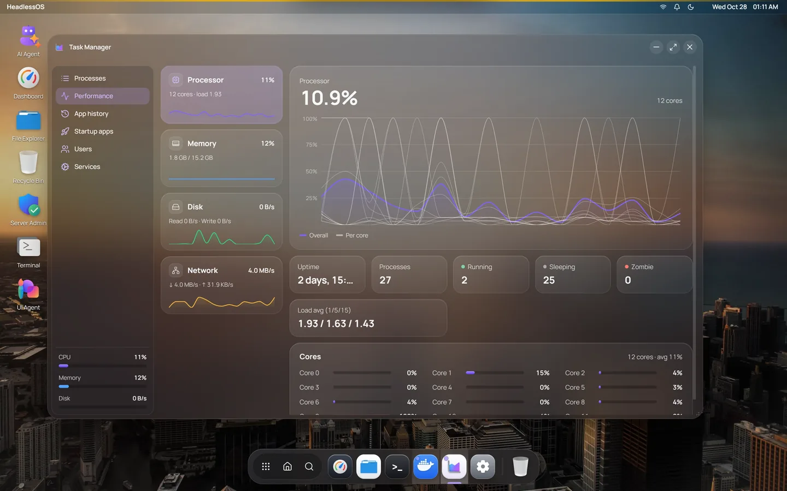
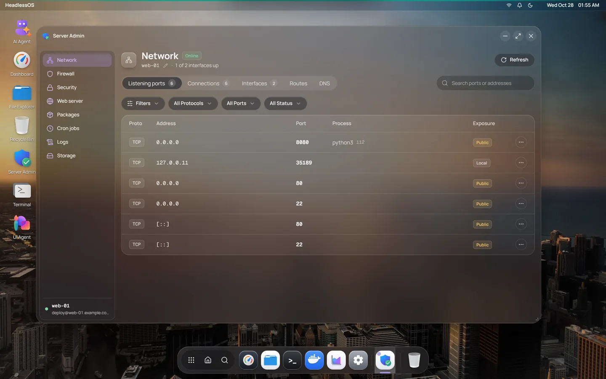
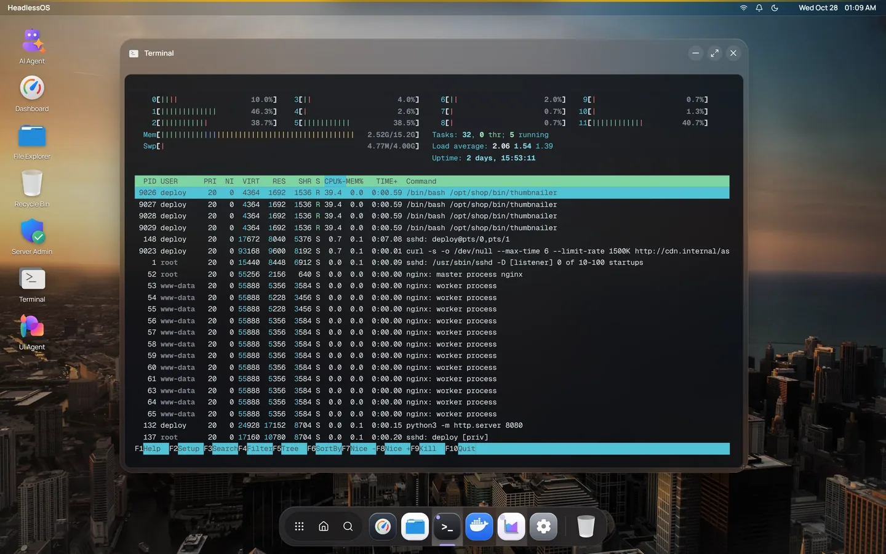
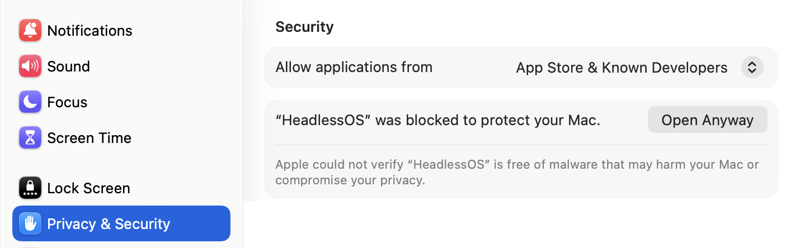

<div align="center">


# HeadlessOS

**Give every server a desktop.**

Open any Linux server you can SSH into and use it like your own computer.<br>
Nothing is installed on the server.

[](https://github.com/abhee235/headlessos/releases/latest)
[](LICENSE)
[](https://headlessos.com/download)

**[Download](https://headlessos.com/download)** · **[Website](https://headlessos.com)** · **[Documentation](https://headlessos.com/docs/introduction)** · **[Blog](https://headlessos.com/blog)** · **[Changelog](CHANGELOG.md)**

</div>

https://github.com/user-attachments/assets/077ada69-0733-4d6d-b1a4-3dabbfe6571b

HeadlessOS is a free desktop app for Windows, macOS and Linux. Point it at a VPS, a cloud server, a home lab or a Raspberry Pi, and the server opens as a desktop: drag files, restart containers, watch the CPU and read logs in real windows. It signs in over SSH and runs the same commands you would, so there's nothing to install on the server and nothing left behind.

## Why HeadlessOS

Is the disk full? Which container restarted? What's eating the CPU? On a server, each answer is another command to remember:

```bash
df -h | grep -v tmpfs
docker ps --format 'table {{.Names}}\t{{.Status}}'
ps aux --sort=-%cpu | head
sudo journalctl -u nginx --since -1h | grep err
```

You want what you have on your own computer: Explorer for files, Task Manager for processes, Docker Desktop for containers. But you don't want to install a 500 MB GUI on a $5 VPS. HeadlessOS gives you that desktop without touching the server. It asks for you and keeps the answers on screen.

- **Nothing on the server.** Web panels like Cockpit or Webmin are installed on each server and served from it. HeadlessOS signs in with the key, agent or password you already use, on the port you already have open, and uses the tools the server already has. No agent, no new port, no account.
- **No commands to memorize.** 31 built-in parsers read `df`, `ps`, `docker` and friends instantly. An AI model steps in only for output they don't recognize, and only if you add one.
- **Private by default.** The app runs on your computer and listens on localhost only. Saved passwords and keys are encrypted on your disk. No cloud, no telemetry.
- **Free and open source.** MIT licensed, with nothing to sign up for.

## What's inside

Each app runs the commands you'd type and shows the answer as an interface. Windows move, resize and snap, and remember where you put them.

<table>
  <tr>
    <td width="50%"></td>
    <td width="50%"></td>
  </tr>
  <tr>
    <td><b>Dashboard.</b> Processor, memory, disks, network and uptime on one live screen.</td>
    <td><b>Files.</b> Browse, upload, rename and edit over SFTP, with a real code editor and a recycle bin you can restore from.</td>
  </tr>
  <tr>
    <td></td>
    <td></td>
  </tr>
  <tr>
    <td><b>Docker.</b> Containers, images, ports and logs. Start, stop and restart without remembering a flag.</td>
    <td><b>Task Manager.</b> Live CPU, memory, disk and network, plus every process, who owns it and what it costs.</td>
  </tr>
  <tr>
    <td></td>
    <td></td>
  </tr>
  <tr>
    <td><b>Server Admin.</b> Network, firewall, security, web server, packages, cron jobs, logs and storage, as forms and tables instead of man pages.</td>
    <td><b>Terminal.</b> When you want the shell, it's one click away: a real terminal with a persistent session, tabs and your own theme.</td>
  </tr>
</table>

**Every server gets its own desktop.** Sign in to several at once and switch in a click. Each one keeps its windows, wallpaper and layout, and comes back as you left it.

## Ask your server what's wrong

Ask "why is the disk full?" and get a view, not a wall of text.

- The **AI Agent** investigates a question and answers with what it looked at.
- The **UI Agent** builds a custom view from a plain-language request, live as it gathers data.
- The **LLM Observatory** shows every model and tool call of a run, with tokens, latency and cost.

Use OpenAI, Claude, or an [Ollama](https://ollama.com) model that never leaves your machine. The AI is optional: everything else works without a key.

## Safe to point at a real server

- **It stays on your computer.** The app listens on localhost only, behind a per-install token. No cloud, no telemetry.
- **Your secrets stay encrypted.** Saved passwords, SSH keys and AI keys are encrypted on your disk.
- **The agents can't improvise.** They choose from a fixed catalog of checked actions, and HeadlessOS builds and runs the command. They never run a shell command a model wrote.
- **Nothing changes without your yes.** Changes wait for your approval and go to an audit log. Files are backed up before they're edited, and put back if a check fails.
- **Models don't see your secrets.** Passwords and keys are stripped from command output before a model sees it.

[SECURITY.md](SECURITY.md) lists what is stored and what is sent where, and [docs/SECURITY.md](docs/SECURITY.md) has the threat model.

## How it works

HeadlessOS isn't an operating system. It's a GUI for your Linux server that runs on your computer.

1. **It runs on your side,** as a desktop app for Windows, macOS or Linux, or in your browser on localhost. The windows, the parsing and the AI all live there.
2. **It signs in like you do,** over SSH. It runs the same commands you would and turns the answers into windows.
3. **Your server stays exactly as it was.** It keeps its own OS, packages and config, and nothing is left behind when you close the app.

## Download

Get the app from the [download page](https://headlessos.com/download) or from [Releases](https://github.com/abhee235/headlessos/releases/latest):

| System | File |
|--------|------|
| Windows 10 or 11, 64-bit | `HeadlessOS.Setup.<version>.exe` (installer) or `HeadlessOS.<version>.exe` (portable) |
| macOS 11 or later, Apple silicon and Intel | `HeadlessOS-<version>-universal.dmg` |
| Linux, 64-bit | `HeadlessOS-<version>.AppImage`, or `headlessos-desktop_<version>_amd64.deb` for Debian and Ubuntu |

Then add a server (host, user, and a key, agent or password) and connect. Your first server opens in about a minute. To use an AI, open **Settings → AI** and choose OpenAI, Claude or a local Ollama model. Keys are stored encrypted on your computer ([SECURITY.md](SECURITY.md)).

The app isn't code-signed yet, so the first launch shows a warning:
- **Windows:** in SmartScreen choose **More info** → **Run anyway**.
- **macOS:** follow [First launch on a Mac](#first-launch-on-a-mac).

### First launch on a Mac

The app isn't signed with an Apple developer certificate, so macOS blocks it the first time you open it. You allow it once:

1. Drag **HeadlessOS** to **Applications** and open it. macOS says it can't open the app. Click **Done**, not **Move to Trash**.
2. Open **System Settings → Privacy & Security** and scroll down to **Security**.
3. Next to "HeadlessOS was blocked to protect your Mac", click **Open Anyway**, then confirm with your password or Touch ID.



macOS remembers this for the copy you installed, so you won't be asked again. A new version is a new download, so it needs the same step once.

If macOS says the app "is damaged", run `xattr -cr /Applications/HeadlessOS.app` in Terminal and open it again.

HeadlessOS keeps the key to your saved logins in the macOS Keychain, so other apps can't read it. When macOS asks, enter your Mac password and click **Always Allow**. Because the app isn't signed, this can happen once after each update. If any other app ever asks for "HeadlessOS Safe Storage", click **Deny**.

## Run it from source

Prefer the browser? You need Node.js 20 or later and npm 9 or later.

```bash
git clone https://github.com/abhee235/headlessos.git
cd headlessos
npm install
npm run dev        # then open http://localhost:3000
```

- **A server to try it on:** `cd dev && docker compose up -d` starts a local Ubuntu container with SSH on `127.0.0.1:2222` (user `testuser`, password `testpass`).
- **An AI key is optional.** Add one later in **Settings → AI**, or put an OpenAI key in `.env` (`cp .env.example .env`, at the repo root).
- **No key and no model?** Start with `LLM_PROVIDER=fake` to run the UI Agent end to end on scripted answers.

## FAQ

<details>
<summary><b>Is HeadlessOS an operating system?</b></summary>

No. The name is a nod to headless servers: machines with no screen that you manage through a terminal. HeadlessOS is an app that runs on your computer and gives those servers a desktop-style interface over SSH. Your server keeps its own operating system, and nothing on it is replaced.
</details>

<details>
<summary><b>Does it install anything on my server?</b></summary>

No. It connects over standard SSH and runs the same tools you would: `ls`, `df`, `ps`, `docker`, `systemctl` and so on. If a tool isn't there (say, Docker), the matching app tells you instead of installing it. No package, service or port is ever added. HeadlessOS only changes what you ask it to, and deleted files go to a recycle bin you can restore from.
</details>

<details>
<summary><b>Which servers does it work with?</b></summary>

Any Linux machine you can reach over SSH: a cloud VPS, a home-lab box, a Raspberry Pi, a VM. Sign in with a key, your SSH agent, or a password.
</details>

<details>
<summary><b>Do I need an AI or OpenAI key?</b></summary>

No. Dashboards, files, Docker, processes, the terminal and admin tools all work without one. Add a key in **Settings → AI** to turn on the agents and to read output the parsers don't know. It works with OpenAI, Claude, or a local Ollama model that never leaves your machine.
</details>

<details>
<summary><b>How is it different from Cockpit, Webmin or Portainer?</b></summary>

Those are installed on the server and served from it, so they need a package, a service and an open port on every machine. HeadlessOS runs on your computer instead, works across all your servers at once, and leaves each of them untouched. The blog has [a longer comparison](https://headlessos.com/blog/cockpit-vs-webmin-vs-headlessos).
</details>

<details>
<summary><b>Is it really free?</b></summary>

Yes. HeadlessOS is MIT licensed and the whole thing is on GitHub. No account, no paid tier, no telemetry.
</details>

## Logs and bug reports

Found a bug? [Open an issue](https://github.com/abhee235/headlessos/issues). To report a vulnerability, see [SECURITY.md](SECURITY.md) instead.

The desktop app writes a log to `~/.headlessos/logs/headlessos.log`. To open it, go to **Global Settings → Open log** on the sign-in screen, or **Settings → About** once you're connected. It's also under the **Help** button in Control Center, and **Help → Open Logs** in the menu bar.

It holds failures and the app's own events, not what you open. Passwords, API keys, tokens, server addresses and logins are kept out, and it's never sent anywhere. An error can still name a file or a server, so read it before you paste it into an issue.

Run from source, the same output goes to the terminal running `npm run dev`.

## Contributing

HeadlessOS is built documentation-first: every change starts as a task in a phase doc, and lands with its tests. [CONTRIBUTING.md](CONTRIBUTING.md) covers setup, how the code is organized, where the docs are, and what a pull request needs. AI coding assistants follow [AGENTS.md](AGENTS.md).

If HeadlessOS saves you a few commands, starring the repo helps other people find it.

## License

[MIT](LICENSE)
